# 빈틈노트

**강의자료와 교수님 강의 녹음 속 강조점, 메타인지 진단으로 시험 전 공부 우선순위를 정해주는 AI 서비스**

*BintmNote finds likely exam topics in lecture slides and recordings, checks what you really know, and builds a study order with page-cited notes.*

- 배포 URL: https://bintm-note-zeclhcenmubbwjrsrz5bqt.streamlit.app
- 저장소: https://github.com/dodohun2212/bintm-note
- KOREATECH AI 실습형 이벤트 · Build for Students · 2026-11-11

## 요약

- **문제**: 시험 전 자료는 많은데 어디부터 볼지 모릅니다. 교수님이 "이건 꼭 알아두세요"라고 한 말은 녹음 속에 묻혀 있고, 안다고 생각한 것과 실제로 아는 것은 다릅니다.
- **누구를 위해**: 강의자료(PDF/PPTX)와 수업 녹음(또는 대본)으로 시험을 준비하는 대학생.
- **어떻게**: 자료와 녹음에서 출제 신호를 찾아 개념별 **출제 가능성 점수**를 매기고(0~100, 가장 높은 개념 = 100점인 비교용 점수. 규칙 기반, 코드가 계산), 개념마다 **진단 문제**(객관식·서술형, 트리·배열 그림 포함)로 실제 이해도를 확인합니다. 그다음 **출제 점수 × 모르는 정도**로 공부 순서를 정하고, 자료 쪽 번호를 인용한 오답노트와 시험 대비 요약 노트를 만들어 줍니다.
- **바로 써 보기** (키·파일 필요 없음):
  1. 배포 URL에서 **"샘플 자료로 체험하기"**를 누르면 출제 순위가 나옵니다.
  2. **"개념 진단하기"** → **"예시 답 채우기"**(정답·반쯤 맞은 답·찍은 답·'모르겠어요'를 섞어 채움) → **"채점하기"**를 누릅니다. 직접 풀어도 됩니다.
  3. **"공부 순서 보기"**에서 공부 순서·오답노트·요약 노트를 보고 내려받습니다.

  AI를 기다리는 시간은 모두 합쳐 약 1분 15초입니다(2026-11-09 배포 앱 실측: 분석 1초 미만 + 문제 25초 + 채점 15초 + 보완 설명·요약 노트 34초). 샘플 분석 결과는 서버에 저장돼 있어 바로 끝나고, 서버가 다시 켜진 뒤 처음 한 번만 약 55초 걸립니다. 문제를 푸는 시간은 따로 듭니다.

  앱을 한동안 아무도 쓰지 않으면 Streamlit이 앱을 재웁니다. "This app has gone to sleep" 화면이 보이면 **Yes, get this app back up!**을 누르고 30초쯤 기다리세요(2026-11-10에 잰 값: 약 30~38초). 깨어난 뒤 첫 분석은 서버에 저장된 결과가 없어 1분쯤 걸립니다(잰 값: 54.8초, 64.3초).
- **결과 예시**: 앱을 열지 않고 결과물을 보려면 [docs/결과_예시](docs/결과_예시/README.md)를 보세요. 샘플 자료로 실제 AI를 한 바퀴 돌려 만든 공부 순서·오답노트와 시험 대비 요약 노트, 만든 조건과 잰 값이 있습니다(2026-11-10, `scripts/make_example.py`).

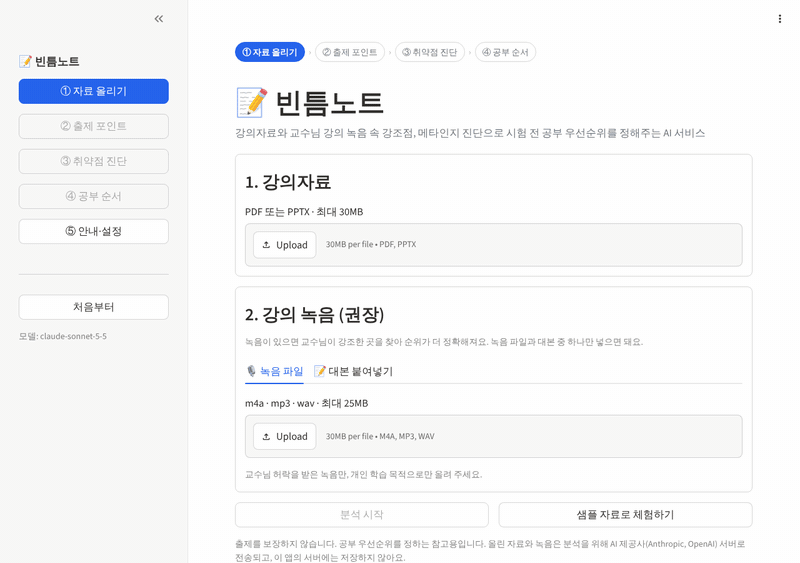

> 출제를 보장하지 않습니다. 공부 우선순위를 정하는 참고용입니다.

## 무엇을 하는 앱인가

| 기능 | 하는 일 | 화면 |
|---|---|---|
| ① 출제 포인트 레이더 | 강의자료와 녹음(또는 대본)에서 출제 신호(학습목표, 본문 쪽수, 예제, 연습문제, 교수님 강조 발화)를 모아 개념별 **출제 가능성 점수**와 근거를 보여줍니다 | ② |
| ② 내 취약점 진단 | 출제 점수 20점 이상인 개념 **전부**에 자료 기반 진단 문제(객관식·서술형, 필요하면 그림 포함)를 1개씩 냅니다. 객관식은 코드가, 서술형은 AI가 루브릭으로 채점해 **앎 / 헷갈림 / 모름**을 정합니다. 찍어서 맞힌 객관식은 "헷갈림"으로 봅니다 | ③ |
| ③ 우선순위 보완 학습 | 출제 점수 × (1 − 이해도)로 공부 순서를 정하고, 개념마다 문제·내 답·채점·정답·자료 쪽을 인용한 보완 설명을 한 장에 담은 **오답노트**를 만듭니다 | ④ |
| ④ 시험 대비 요약 노트 | 강의 순서대로 **모든 개념**을 정리합니다. 급하거나 출제 점수가 높거나 틀린 개념은 자세히(핵심·자주 하는 실수·교수님 말 포함), 나머지는 짧게 씁니다 | ④ 둘째 탭 |

<details>
<summary>스크린샷 보기 (13장)</summary>

2026-11-09 배포 앱에서 실제 AI로 "샘플 자료로 체험하기"를 끝까지 돌리며 찍었습니다. 출제 점수를 %로 표기하던 때의 화면이라 점수가 "100%"처럼 보입니다. 지금은 "100점"으로 표기합니다.

| ① 자료 올리기 | ② 출제 포인트 레이더 |
|---|---|
| 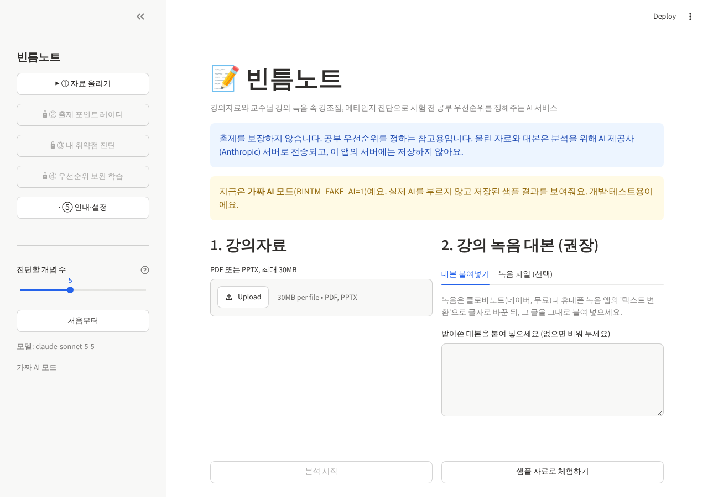 | 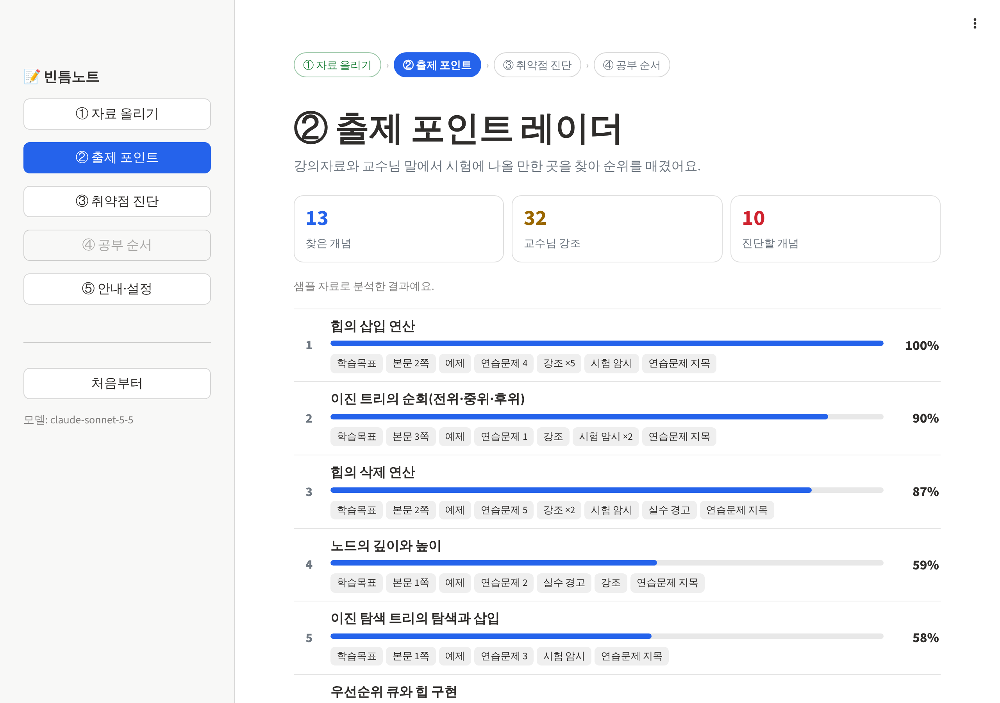 |

| ③ 예시 답 채우기 (샘플 체험용) | ③ 누르면 모든 문제가 채워짐 |
|---|---|
| 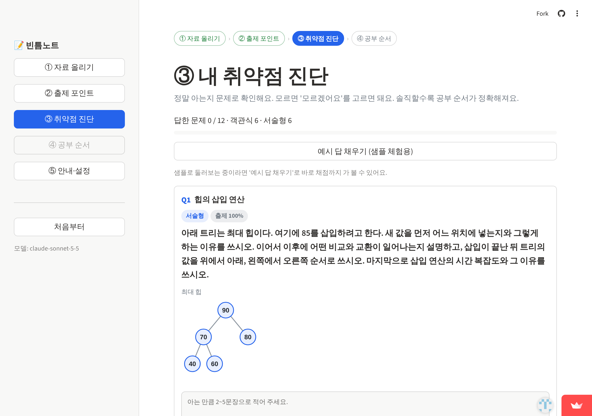 | 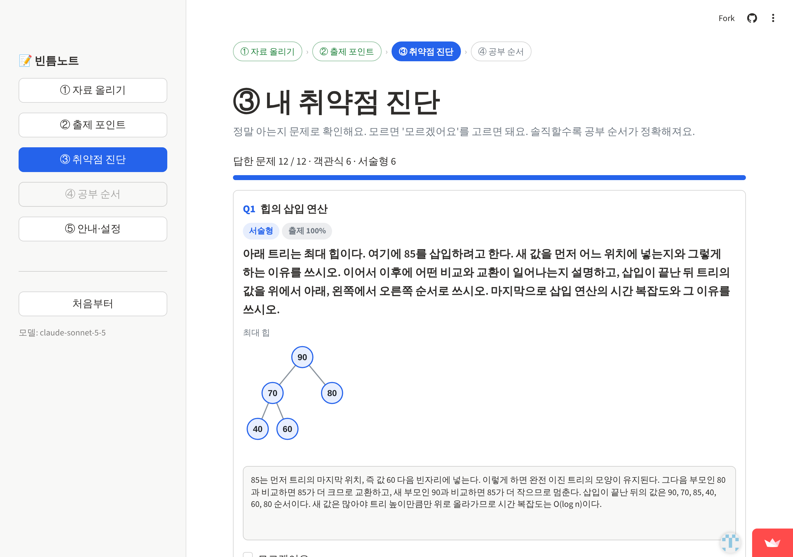 |

| ③ 내 취약점 진단 (문제 그림 포함) | ③ 답하지 않은 문제가 있으면 채점하지 않음 |
|---|---|
| 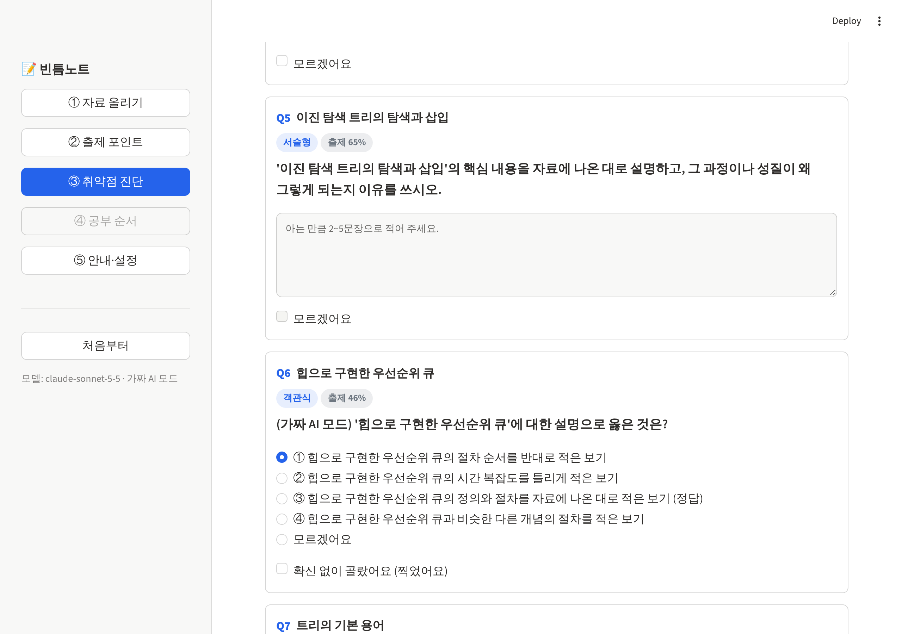 | 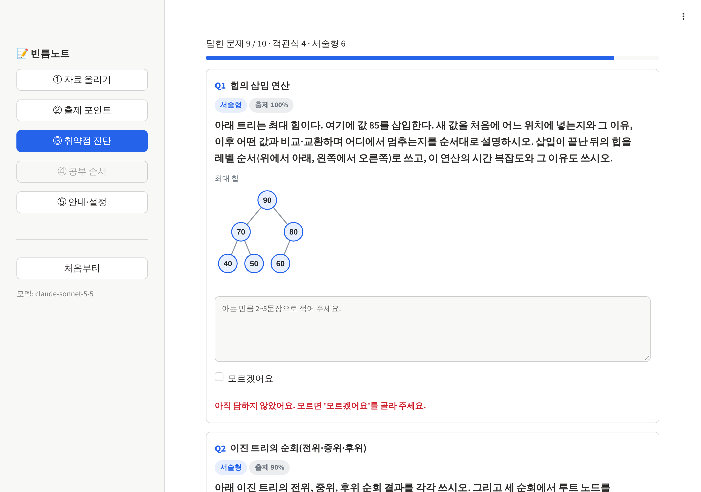 |

| ③ 찍었으면 헷갈린 점 적기 (선택) | ④ 헷갈린 점에 대한 답 |
|---|---|
| 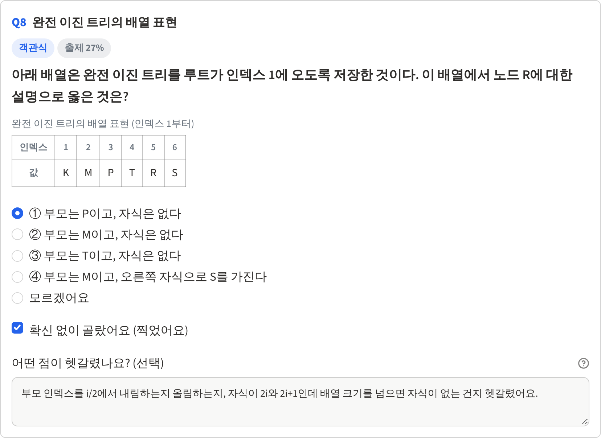 | 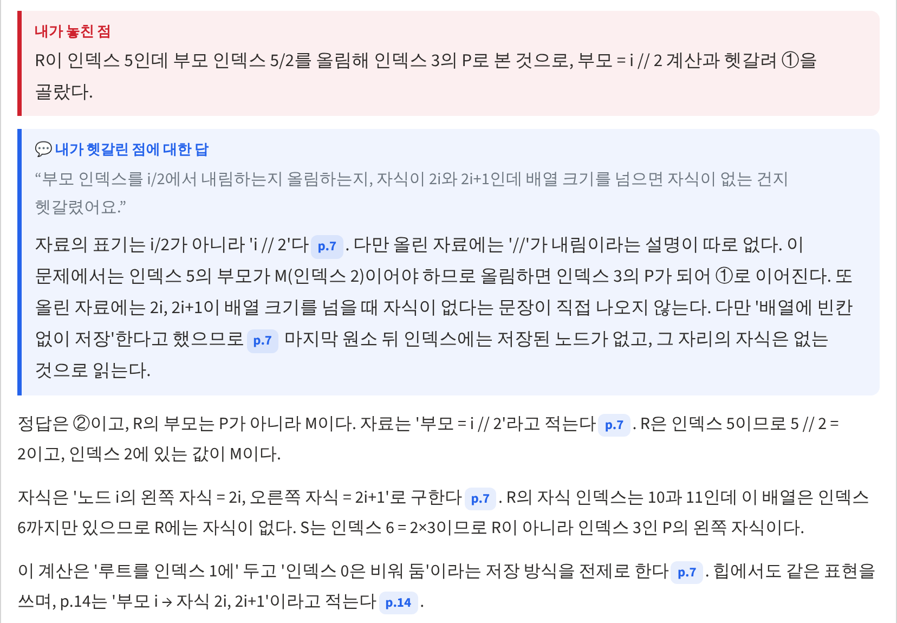 |

| ③ 채점 결과 | ④ 우선순위 보완 학습 |
|---|---|
| 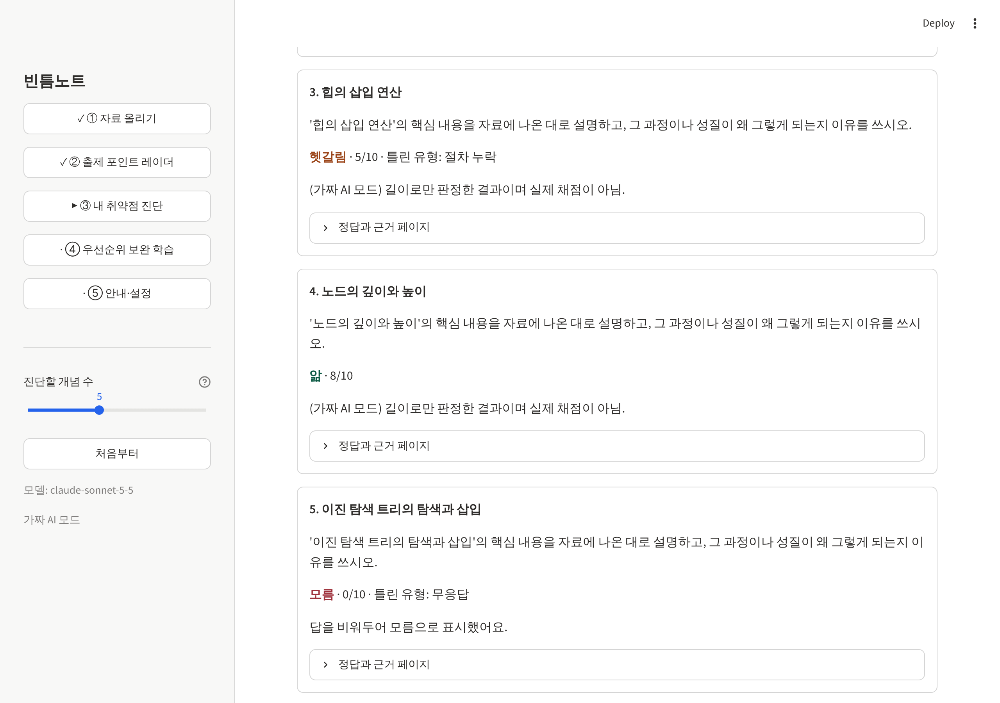 | 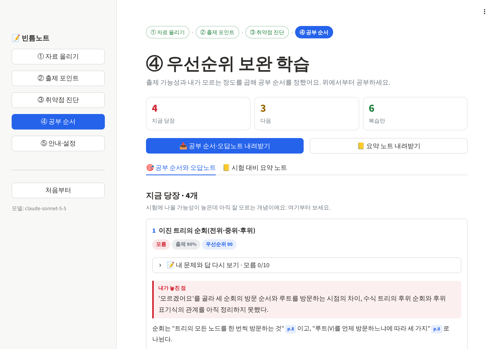 |

| ④ 시험 대비 요약 노트 | 내려받은 요약 노트 |
|---|---|
| 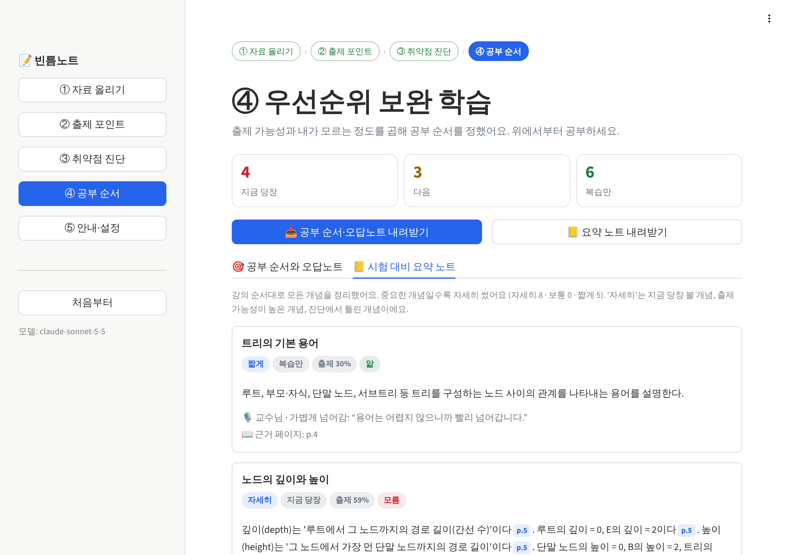 | 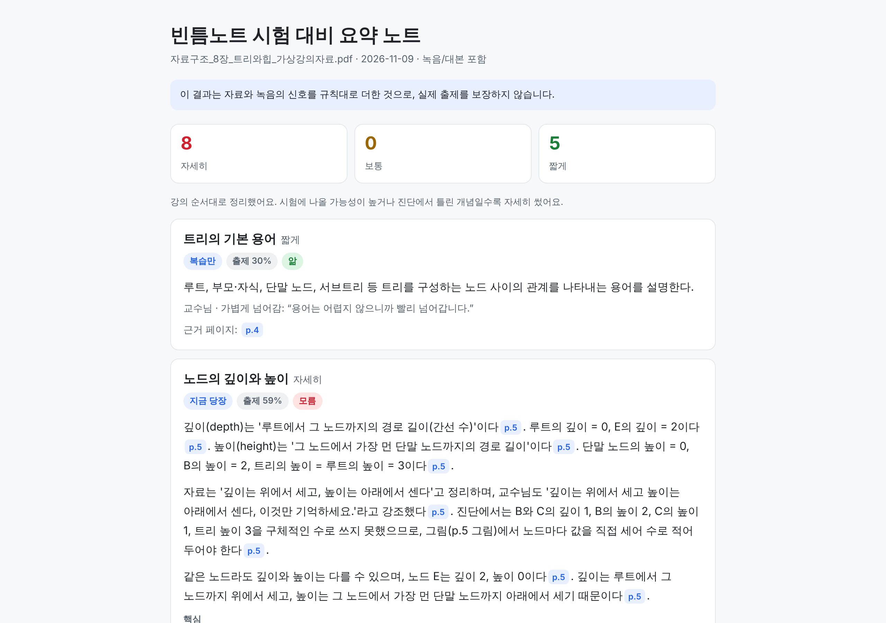 |

| 내려받은 공부 순서·오답노트 |
|---|
| 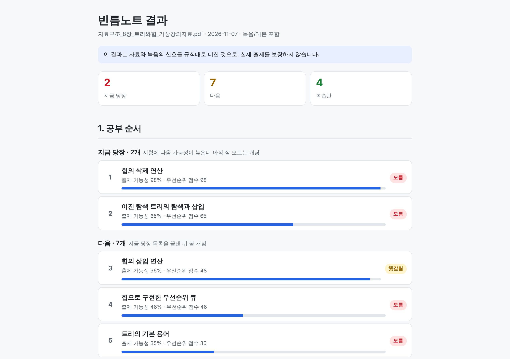 |

</details>

## 사용 방법

1. **① 자료 올리기**: 강의자료(PDF/PPTX, 30MB 이하) 1개를 올립니다. 녹음(m4a/mp3/wav, 25MB 이하)을 올리거나 받아쓴 대본을 붙여 넣습니다(클로바노트 같은 받아쓰기 앱의 글을 그대로 붙여 넣으면 됩니다). 둘 다 없어도 자료만으로 동작합니다. **분석 시작**을 누릅니다.
2. **② 출제 포인트 레이더**: 개념별 출제 가능성 막대와 근거 배지(학습목표, 본문 쪽수, 예제, 연습문제, 교수 강조 횟수)를 봅니다. 문제 형식(섞어서 / 모두 객관식 / 모두 서술형)을 고르고 **진단하기**를 누릅니다. 시간이 없으면 **빠른 진단**을 켜서 출제 점수 상위 5개만 풀 수 있습니다(기본은 꺼짐. 나머지는 '진단 안 함'으로 계산).
3. **③ 내 취약점 진단**: 모든 문제에 답하고 **채점하기**를 누릅니다. 답하지 않은 문제가 있으면 채점하지 않고 그 문제 아래에 빨간 글씨로 알려 줍니다. 모르면 "모르겠어요"를 고릅니다(객관식은 다섯째 보기, 서술형은 체크 상자). 객관식을 찍었다면 "확신 없이 골랐어요"를 체크하고, 생기는 칸에 무엇이 헷갈렸는지 적을 수 있습니다(선택, 예: "②와 ③ 중에 고민했어요"). 적으면 ④에서 그 질문에 바로 답합니다. 서술형 채점이 실패한 문제는 표시가 남고 **채점 못한 문제 다시 채점**으로 그 문제만 다시 채점합니다.
4. **④ 우선순위 보완 학습**: 첫 탭 **공부 순서와 오답노트**에서 "지금 당장 / 다음 / 복습만"으로 묶인 개념마다 "내 문제와 답 다시 보기"와 보완 설명을 봅니다. 자료에 없는 내용은 "올린 자료에서 찾지 못함"으로 따로 표시합니다. "강의자료 원본 보기"를 펼치면 근거 페이지 그림이 나옵니다. 둘째 탭은 **시험 대비 요약 노트**입니다. 내려받기는 **공부 순서·오답노트**와 **요약 노트** 두 파일이고, 둘 다 브라우저에서 바로 열립니다(원본 페이지 그림은 넣지 않음).

파일이 없으면 **샘플 자료로 체험하기**를 누르세요. 우리가 직접 만든 가상 강의자료(자료구조 8장 트리와 힙, 20쪽)와 녹음 대본으로 끝까지 돌려 볼 수 있습니다.

배포 앱은 운영자 키 하나로 모두가 함께 쓰므로, 화면 하나에서 분석(샘플 포함)은 5번까지, 서버 전체로는 하루 150번까지 할 수 있습니다(`config.py`의 `MAX_ANALYSES_PER_SESSION`, `MAX_ANALYSES_PER_DAY`). 이미 받은 결과는 횟수와 상관없이 계속 볼 수 있습니다.

## 어떻게 동작하나

AI는 **읽고 분류하고 설명하는 일**만 하고, **점수·순위·이해 상태 판정은 코드**가 합니다. AI가 찾은 신호(학습목표, 교수님 강조 등)가 같으면 항상 같은 점수가 나오므로 테스트와 검증이 가능합니다. 신호를 찾는 일은 AI가 하므로, 같은 자료를 처음부터 다시 분석하면 신호와 점수가 조금 달라질 수 있습니다(같은 파일은 서버에 저장된 결과를 다시 써서 그대로입니다).

```text
자료 PDF/PPTX ─ 텍스트 추출(쪽별) ─┐
                                  ├─ AI① 개념 추출 ─┐
녹음/대본 ─ 음성 인식(STT) ─ AI② 강조 발화 찾기 ─┴─ [코드] 출제 가능성 점수 → ② 화면
                                                        │
            AI③ 진단 문제 생성(객관식·서술형)·서술형 채점 ←┘  → ③ 화면
                                │
                        [코드] 우선순위 = 출제 점수 × (1 − 이해도)
                                │
                        AI④ 보완 설명(근거 쪽 인용) + AI⑤ 요약 노트 → ④ 화면 → HTML 2개 내보내기
```

- **AI 호출**: 5종(프롬프트 7개: 01 개념, 02 강조 발화, 03A 서술형 문제, 03B 서술형 채점, 03C 객관식 문제, 04 보완 설명, 05 요약 노트)이고 모두 `core/llm.py`의 `ask_json()` 하나를 거칩니다. 프롬프트는 `prompts/*.md` 파일을 읽어 `{{자리}}`만 채웁니다.
- **근거 페이지만 보내기(RAG)**: 호출 1(개념 추출)만 자료 전체를 보냅니다. 호출 3, 4, 5는 그 개념이 나오는 페이지 텍스트만 보냅니다(최대 8쪽). 벡터 DB는 쓰지 않습니다.
- **객관식**: AI가 보기 4개와 정답 위치를 만들면, 코드가 형식을 검사하고 보기 순서를 섞은 뒤(정답이 한 자리에 몰리지 않게) 채점까지 합니다. 형식이 맞지 않으면 서술형 문제로 대신 냅니다. 개념마다 문제를 동시에 만들기 때문에, 함께 진단하는 다른 개념 이름을 프롬프트에 넣어 같은 내용(예: 배열 인덱스 계산)을 다시 묻지 않게 합니다.
- **문제 그림**: AI에게는 자료의 글자만 가므로 자료 속 그림의 모양을 알 수 없습니다(트리 그림이 "+ * - a b"처럼 글자 조각으로 들어감). 그래서 트리·배열·표가 필요하면 AI가 작은 예를 **데이터(JSON)로** 만들고, 코드(`core/figure.py`)가 그립니다. 문제 글이 "p.9 그림 참고"처럼 학생이 볼 수 없는 것을 가리키면 코드가 잡아내 한 번 더 만들게 합니다. 문제 그림은 새로 만든 예시라 교재 그림과 다를 수 있어서, 채점·설명 AI에게 그 차이로 "교재에 오기가 있다"고 쓰지 말라고 지시합니다.
- **원본 페이지 그림**: 화면의 "강의자료 원본 보기"를 펼치면 근거 페이지를 그림으로 보여줍니다(`core/pageimg.py`, PDF만). 화면에만 쓰고 AI에도, 내려받는 파일에도 넣지 않습니다.
- **AI 답 검사**: 응답은 전부 JSON으로 받아 형식을 검사합니다. 인용 문장이 대본에 실제로 있는지, 인용 쪽이 입력 범위 안인지 코드가 확인합니다. 목록에서 형식이 틀린 항목은 그 항목만 버리고 계속하며, 쪽 번호를 "3-4"나 "p.5"처럼 글자로 줘도 숫자로 읽습니다. "내가 놓친 점"이 진단 결과와 맞지 않으면(예: '모르겠어요'를 골랐는데 "아직 확인하지 않은 개념") 코드가 바로잡습니다.
- **채점이 멈추지 않게**: AI가 루브릭 점수를 2.5 같은 부분 점수나 빈 값으로 줘도 코드가 정수로 바꾸고 항목 배점을 넘지 않게 자릅니다. 문제 만들기, 채점, 설명, 요약 노트는 하나가 실패해도 나머지는 진행하고, 실패한 것만 표시해 다시 할 수 있게 합니다. 답이 길이 상한에 걸려 잘리면 상한을 두 배로 늘려 한 번 더 받습니다(`config.py`의 `AI_MAX_TOKENS` 4000, `NOTE_MAX_TOKENS` 5000).
- **헷갈린 점에 답하기**: 학생이 적은 헷갈린 점(300자까지)은 호출 4에 `<student_confusion>`으로 따로 넣고, AI가 자료 페이지를 인용해 바로 답합니다. 이 글은 학생의 질문으로만 읽고 지시로 따르지 않게 했고, 꺾쇠(<, >)는 코드가 다른 글자로 바꿔 태그를 닫을 수 없게 합니다. 적은 게 없으면 AI가 답을 써도 버립니다. 헷갈린 점을 적은 개념은 순위와 상관없이 보완 설명을 자동으로 만듭니다(개념당 호출 1번).
- **요약 노트의 자세한 정도는 코드가 정합니다**(`core/note.py`): "지금 당장"이거나 출제 점수 50점 이상이거나 진단에서 모름인 개념은 자세히, "다음"이거나 헷갈린 개념은 보통, 나머지는 짧게. "짧게"는 AI를 부르지 않고 개념 추출 때 받은 한 줄 요약을 씁니다.
- **API 비용 보호**(`core/guard.py`): 세션당 분석 횟수와 서버 전체 하루 분석 횟수를 셉니다. 분석이 실패하면 센 횟수를 돌려줍니다. 개념 추출·강조 발화는 같은 파일이면 서버에 저장된 결과를 다시 쓰고, 샘플 자료의 진단 문제도 한 번 만들면 다음 사람에게 그대로 냅니다. 채점·보완 설명·요약 노트는 학생의 답에 따라 달라서 매번 만듭니다.

### 출제 가능성 점수 (가중치 v0, `core/score.py`)

| 신호 | 점수 |
|---|---|
| 학습목표에 있음 | +3.0 |
| 본문 쪽수 | 쪽당 +1.0, 최대 4쪽 |
| 예제·그림으로 과정 설명 | +1.5 |
| 연습문제에 포함 | +2.0 |
| 교수 강조 발화 ("꼭 알아두세요") | +1.0 × 강도/3, 발화마다 |
| 시험 암시 ("시험에 나옵니다") | +1.5 × 강도/3 |
| 실수 경고 ("실수가 많아요") | +0.7 × 강도/3 |
| 연습문제 지목 ("4번 꼭 풀어보세요") | +1.0 × 강도/3 |
| 다음에 다룸 ("다음 주에 봅니다") | −2.5 |
| 가볍게 넘어감 ("참고만 하세요") | −1.0 |

음수는 0으로 자르고, 가장 높은 개념을 100점으로 두어 0~100점으로 보여줍니다. 개념끼리 비교하는 점수이며 확률이 아니라서 %를 쓰지 않습니다. 메타 페이지(표지, 목차, 학습목표, 연습문제, 요약)는 본문 쪽수에서 뺍니다.

### 이해도와 우선순위 (`core/priority.py`)

- 서술형: 채점 8점 이상 **앎**(이해도 1.0), 4~7점 **헷갈림**(0.5), 3점 이하 **모름**(0.0)
- 객관식: 확신하고 맞힘 **앎**, 찍어서 맞힘("확신 없이 골랐어요") **헷갈림**, 틀림·모르겠어요 **모름**. 맞힌 것과 아는 것을 구분하려는 메타인지 장치입니다
- 우선순위 = 출제 점수(0~100) × (1 − 이해도). 50 이상 "지금 당장", 20~49 "다음", 20 미만 "복습만"
- **진단 대상**: 출제 점수 20점 이상인 개념 전부. 20점 미만은 진단 결과와 상관없이 우선순위가 20 미만("복습만")이라 문제를 내지 않습니다("진단 안 함", 이해도 0.5)
- **문제 형식 "섞어서"(기본)**: 출제 점수 50점 이상은 서술형으로 깊게, 나머지는 객관식으로 빠르게. 서술형은 여러 개를 연달아 풀어도 부담이 크지 않게 한 문제에 최대 2가지만 묻고 2~3문장으로 답할 크기로 만듭니다

### 모델과 교체 방법

- 언어 모델: Anthropic Claude `claude-sonnet-5-5` (`config.py`의 `LLM_MODEL` 한 줄로 교체. 예: `claude-haiku-5-5`)
- 음성 인식: OpenAI `whisper-1` (`config.py`의 `STT_MODEL`. `None`이면 대본 붙여넣기만 사용)
- 자체 모델을 학습하지 않았습니다. 상용 모델 위에 우리 프롬프트, 근거 페이지 검색, 점수 규칙을 얹은 구조입니다.

## 로컬 실행

```bash
pip install -r requirements.txt
mkdir -p .streamlit
# .streamlit/secrets.toml 에 아래 두 줄을 만들고 본인 키를 넣는다 (파일은 git에 올라가지 않음)
#   ANTHROPIC_API_KEY = "..."
#   OPENAI_API_KEY = "..."      # 녹음 받아쓰기용. 없으면 대본 붙여넣기만 가능
streamlit run app.py
```

키 없이 화면만 보려면 가짜 AI 모드로 실행합니다. 저장된 샘플 결과를 보여줄 뿐 실제 AI를 부르지 않습니다.

```bash
BINTM_FAKE_AI=1 streamlit run app.py
```

## 테스트

AI를 부르지 않는 자동 테스트 69개(`tests/`)가 점수·우선순위·이해 상태 판정, 텍스트 추출과 개인정보 가리기, AI 답 검사(인용·쪽 번호·형식이 틀린 항목), 객관식·서술형 채점, 문제 그림, 요약 노트, 내려받기 파일, API 비용 보호, 전체 흐름을 확인합니다. 항목별 목록은 [개발기획안 11.1](docs/개발기획안_v1.0.md)에 있습니다.

```bash
python -m pytest -q tests/
# 2026-11-10 GitHub Actions(Ubuntu · Python 3.12) 실행 결과: 69개 모두 통과
```

GitHub에 올릴 때마다 GitHub Actions(`.github/workflows/tests.yml`)가 같은 테스트를 자동으로 돌립니다.

샘플 자료(가상 강의자료 20쪽 + 녹음 대본)에 심어 둔 신호와 비교한 결과(`tests/test_score.py::test_t01`): 상위 3개 = 이진 트리의 순회 · 힙의 삭제 연산 · 힙의 삽입 연산 (기대와 일치), "다음 주에 다시 봅니다"라고 미룬 BST 삭제는 최하위.

버전별 변경과 실제 AI로 확인한 결과, 학생 피드백을 반영한 기록은 [CHANGELOG.md](CHANGELOG.md)에 있습니다.

### 측정값

2026-11-09 배포 앱(당시 v1.4, `claude-sonnet-5-5`)에서 샘플 자료(20쪽 + 대본)로 실제 AI를 써서 브라우저 자동화(Playwright)로 잰 값입니다. 시간은 버튼을 누른 때부터 다음 화면이 다 나올 때까지입니다. 측정하지 않은 숫자는 적지 않습니다.

| 항목 | 값 | 어떻게 쟀나 |
|---|---|---|
| 분석 시작 → ② 화면 (서버에 저장된 결과 없음) | 54.8초 (AI 호출 2번, 입력 15,238 · 출력 9,556 토큰) | 샘플 PDF 끝에 주석 한 줄을 붙여 해시만 바꾼 파일 + 대본으로 "분석 시작", ⑤ 화면 사용량 |
| 샘플 자료로 체험하기 → ② 화면 (저장된 결과 재사용) | 0.8초 (2회 모두 0.8~0.9초) | "샘플 자료로 체험하기" |
| 진단 문제 10개 생성 (서술형 6 · 객관식 4) | 25.4초 · 31.5초 · 39.1초 (3회) | "10개 개념 진단하기" → "채점하기" 버튼이 나올 때까지 |
| 채점 (서술형 5문제 AI 채점) | 11.0초 · 15.0초 (2회) | "채점하기" → 결과 표시 |
| ④ 보완 설명 + 요약 노트 | 34.2초 (1회) | "공부 순서 보기" → 내려받기 버튼이 나올 때까지 |
| 샘플 한 바퀴 전체 토큰 | 입력 94,756 · 출력 58,403 | ⑤ 화면 사용량. 개념 추출·강조 발화를 처음 만들 때 쓴 토큰도 들어 있음 |

## 한계와 향후 계획

- 글자가 그림으로 들어 있는 스캔 PDF는 읽지 못합니다 (안내 문구만). 향후 비전 모델로 글자 인식 예정
- 한 번에 한 장(chapter)만, 최대 120쪽
- 녹음은 25MB(약 60~90분)까지. 길면 잘라 올리거나 대본을 붙여 넣어야 합니다
- 점수는 규칙 기반 추정이며 실제 출제를 보장하지 않습니다. 실제 기출과 비교한 검증은 아직 하지 않았습니다. 기출 시험지와 강의자료를 함께 구하면 `tests/기출_개념표.json`을 채워 "상위 10개 중 실제 출제 개념 수"를 재고(`scripts/compare_exam.py`), 그 결과로 가중치를 조정할 계획입니다
- 실제 교재 한 장(30~44쪽) 분석 시간은 아직 재지 않았습니다(위 측정은 20쪽 샘플)
- 배포 앱의 분석 횟수 제한은 서버 메모리에서 세므로, 서버가 다시 켜지면 하루 횟수가 0부터 다시 셉니다. 키 한도는 AI 제공사 콘솔의 지출 한도로 함께 막습니다
- 로그인·저장 기능이 없어 새로고침하면 결과가 사라집니다 (④에서 HTML 파일 두 개로 내려받기)
- 문제 그림은 이진 트리, 배열, 표 세 가지만 그립니다. 그래프·회로 같은 그림은 글로 풀어 냅니다
- 원본 페이지 그림은 PDF에서만, 화면에서만 보여줍니다 (PPTX는 글만, 내려받는 파일에는 없음)
- 향후: 학우 질문 기록 반영, 여러 장 묶어 보기, 공개 모델로 교체 옵션

## 데이터·저작권·녹음 동의

- 올린 파일은 서버 디스크에 저장하지 않습니다. 분석을 위해 AI 제공사(Anthropic, OpenAI) 서버로 전송됩니다.
- 진단 문제·채점·설명 같은 결과는 그 화면(세션)에만 있습니다(샘플 자료의 진단 문제만 예외로 다음 사람에게 다시 냅니다). 다만 같은 파일을 다시 분석할 때 AI를 또 부르지 않도록, 분석 결과(개념 목록·교수님 강조)와 강의자료 쪽 그림은 서버가 켜져 있는 동안 서버 메모리에 보관합니다(`st.cache_data`). 같은 파일을 올렸을 때만 다시 쓰고, 서버가 다시 켜지면 사라집니다.
- 학번(숫자 8~10자리)·전화번호·이메일은 강의자료와 녹음 대본 모두 AI에 보내기 전에 `[마스킹]`으로 가립니다. 사람 이름은 가리지 않습니다.
- 녹음은 교수님 허락을 받은 것만, 개인 학습 목적으로만 사용해 주세요. 앱은 녹음을 저장하거나 공유하지 않습니다.
- 저장소의 `samples/`는 우리가 직접 만든 가상 자료입니다. 실제 교재·강의 자료와 시험지는 저장소에 넣지 않았습니다.

## 가정 (개발기획안 15장 미정 사항의 기본값)

- 언어 모델 `claude-sonnet-5-5`, 음성 인식 `whisper-1`, 가중치 v0
- 진단 대상은 출제 점수 20점 이상 전부(`DIAG_MIN_PCT`), "섞어서"의 서술형 기준 50점(`ESSAY_MIN_PCT`)
- 자동 보완 설명은 "지금 당장" 전부와 우선순위 상위 3개, 헷갈린 점을 적은 개념. 나머지는 버튼으로 생성
- 헷갈린 점 입력칸은 객관식에만 둡니다(서술형은 답 칸에 그대로 적으면 됩니다)
- 요약 노트는 ④에 들어가면 자동으로 만듭니다("자세히"·"보통"만 AI 호출, "짧게"는 호출 없음)
- 분석 횟수 제한은 세션당 5번(`MAX_ANALYSES_PER_SESSION`), 서버 전체 하루 150번(`MAX_ANALYSES_PER_DAY`). 0으로 두면 제한 없음
- 빠른 진단은 상위 5개(`QUICK_DIAG_TOP`), 기본은 꺼짐

## 폴더 구조

```text
app.py          화면 S01~S05 (Streamlit)
config.py       모델 이름 등 설정 한 줄들
core/           추출·호출·점수·진단·문제 그림·우선순위·설명·요약 노트·페이지 그림·내보내기 (streamlit 의존 없음)
prompts/        AI 호출용 프롬프트 7개 (v1)
samples/        가상 샘플 자료와 대본
scripts/        기출 비교(compare_exam.py), 샘플로 결과 예시 만들기(make_example.py)
tests/          자동 테스트와 저장된 AI 결과(fixtures)
docs/           개발기획안, 스크린샷, 결과 예시(샘플 자료로 실제 AI를 돌린 결과)
.github/        자동 테스트 설정(GitHub Actions)
```

## 팀

팀 빈틈노트 · KOREATECH AI 실습형 이벤트 "Build for Students"
